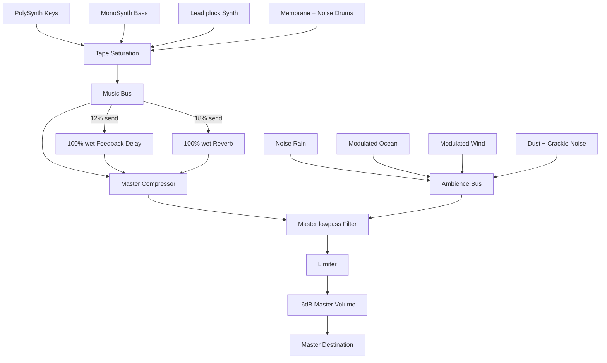

# Audio Engine Specification - KoalaFi

## Audio Pipeline & Routing

All audio in KoalaFi is synthesized procedurally inside the browser using **Tone.js**. The master bus includes compression, a warm lowpass filter, a limiter, and a conservative output volume.

## Automated Audio Quality Gate

`renderMelodyAudit()` and `renderBassAudit()` render generated parts through a real
`OfflineAudioContext`. Playwright rejects silent, clipped, DC-biased, excessively
loud, or over-compressed output using peak, RMS, clipped-sample ratio, DC offset,
and crest-factor metrics. This complements structural generator tests: it verifies
both the notes and the resulting PCM signal.

## Synthesizers & Elements

### 1. Rhodes Chords (PolySynth)

- Sine waves passed through a lowpass filter.
- Warm envelopes: slow attack (150ms) and release (1.8s) to simulate vintage electric pianos.
- Warmth is modulated by cozy levels, which lower the filter cutoff frequency.
- **Tape Wow & Flutter**: A slow LFO (`Tone.LFO` modulating `synth.detune` by ±7 cents at 0.12Hz) adds gentle analog pitch drift.
- **Comping Playback**: Scheduled using soft comping stabs and repeats instead of continuous pads to create rhythmic breathing room.

### 2. Harmonic Bass (MonoSynth)

- Saw oscillator playing octave-2 roots/fifths and octave-3 accents.
- Tight envelope: 8ms attack, 160ms decay, and 160ms release.
- Dynamic lowpass envelope preserves the fundamental while exposing enough harmonics
  to remain audible on laptop and mobile speakers.
- **Grooving Playback**: Lo-fi states use four syncopated attacks per bar; high-energy
  electronic states use a driving five-attack root/fifth/octave pattern.

### 3. Lead Pluck (Synth)

- Harmonic triangle pluck with a 12ms attack, 160ms decay, low sustain, and 320ms
  release.
- **Dynamic Filter Sweep**: A slow LFO (0.07Hz) moves around the focus-controlled
  cutoff without overriding it. The sweep widens from ±80Hz to ±150Hz as focus rises.
- **Vibrato**: A slow LFO (0.18Hz) modulates `synth.detune` by ±8 cents.
- Routed heavily through the auxiliary delay and reverb channels.
- **Phrasing Playback**: Starts a 13-note call in bar 1 and a transformed answer in
  bar 5 of each 8-bar block. Seven core notes always remain audible; complexity adds
  syncopated ornaments.

### 4. Drums

- **Kick**: Short pitch-sweep on a sine oscillator using a `MembraneSynth` (tight decay: 280ms).
- **Snare**: Pink noise burst passed through a bandpass filter centered at 1150Hz (Q: 0.9) for an audible dusty clap.
- **Hi-hat**: Pink noise burst passed through a highpass filter centered at 5200Hz.
- **Beat Patterns**: Lower-energy states use syncopated boom-bap; energy values from
  `0.65` use four-on-the-floor electronic drums. Both remain deterministic.

### 5. Ambience

- **Ocean Waves**: Synced LFOs (0.05Hz) modulate both the volume (0.05 to 0.7) and the lowpass filter cutoff frequency (220Hz to 680Hz) to simulate wave swells.
- **Wind**: Slow LFO (0.035Hz) modulating the cutoff frequency of a warm (Q: 3) bandpass filter (200Hz to 480Hz) on brown noise.
- **Rain**: Soft lowpass (780Hz) pink noise rumble + gentle bandpass droplets (3200Hz, 15ms decay) triggered at irregular time intervals.
- **Vinyl**: Dust rumble (lowpass brown noise) + sparse crackle pops (pink noise, 4ms decay) scheduled on a quarter-note (`4n`) transport queue.

## Lifecycle & Mix Rules

- Audio starts only from a user gesture through `initializeAudio()`.
- UI code calls the engine facade; Tone.js globals and nodes stay inside `src/lib/audio`.
- All `Tone.LFO` instances are cleaned up correctly in the `dispose()` lifecycle.
- `applyState()` regenerates patterns when seed, generator version, key, or scale changes, then updates real-time levels, swing, and filters.
- `dispose()` clears scheduled transport parts before disposing instruments and effects.
- `Tone.start()` is guarded with a timeout so a blocked audio context does not leave the UI waiting forever.
- Volume adjustments are transitioned smoothly using `setTargetAtTime` to prevent sudden jumps, pops, or clicks.
- Delay and reverb are fully wet send effects. Their send gains control spatial depth without
  duplicating the dry music signal.
